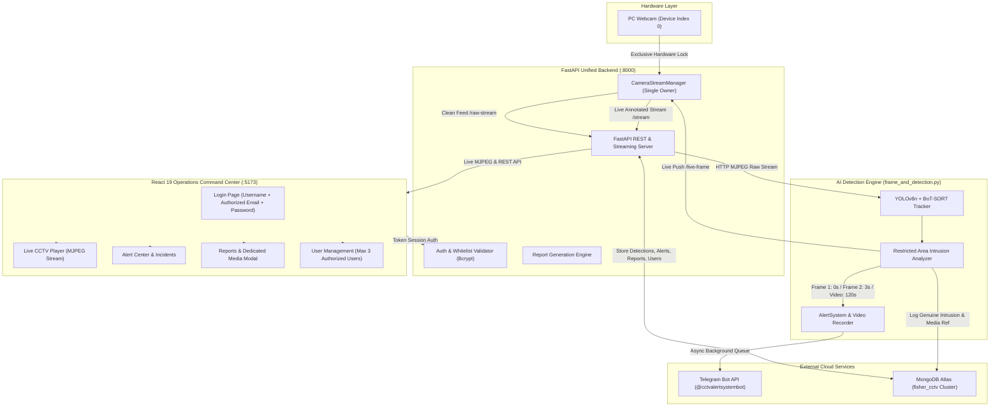

# FISHER AI CCTV — Intelligent Defense & Surveillance Platform

[](https://www.python.org/)
[](https://fastapi.tiangolo.com/)
[](https://react.dev/)
[](https://vitejs.dev/)
[](https://docs.ultralytics.com/)
[](https://www.mongodb.com/atlas)
[](https://core.telegram.org/bots/api)

**FISHER CCTV** is an enterprise-grade AI video surveillance and restricted-area defense system. It integrates computer vision (YOLOv8 and BoT-SORT tracking), real-time physical PC camera ownership, automated Telegram incident escalation with high-resolution evidence capture, MongoDB Atlas persistence, strict 3-user role-based authentication, and a responsive operations dashboard.

---

## Project Team & Assigned Roles

The graduation project responsibilities are assigned by system layer:

| Team member | Assigned layer(s) | Specific responsibilities |
| --- | --- | --- |
| Hawlet Musbah  | **2 — Video Processing** | OpenCV video processing, frame extraction, and video enhancement. |
| Natnaile Desalgn | **3 — AI Detection**  | YOLOv8/YOLO11 object detection; ByteTrack tracking and object ID assignment for people and vehicles; login, camera configuration, alert configuration, and system settings. Fire detection is optional. |
| Sitota Getahun  | **5 — Analytics** | Intrusion detection, crowd counting, loitering detection, restricted-area monitoring, and event classification. |
| Nuhamin Anbese  | **6 — Alerts** | Telegram, email, and SMS alert integration, plus screenshot capture. |
| Bona Tolasa | **7 — Database** | Storage and management of detection logs, alert logs, user data, camera data, and event history. |
|Eman Mohammednur  | **8 — Dashboard**  | Live CCTV feed, detection results, statistics, reports, and user management interfaces. |

These are team responsibility assignments; the implementation and setup sections describe the available functionality.
---

## Table of Contents

- [1. System Architecture](#1-system-architecture)
- [2. Core Features & Capabilities](#2-core-features--capabilities)
- [3. Project Directory Structure](#3-project-directory-structure)
- [4. Installation & Setup](#5-installation--setup)
  - [Prerequisites](#prerequisites)
  - [Python Environment Setup](#python-environment-setup)
  - [Frontend Dashboard Setup](#frontend-dashboard-setup)
  - [Environment Variables (.env)](#environment-variables-env)
- [5. Running the System (Startup Guide)](#6-running-the-system-startup-guide)
- [6. How to Use the Program (Operator Walkthrough)](#7-how-to-use-the-program-operator-walkthrough)
  - [Step 1: Signing In](#step-1-signing-in)
  - [Step 2: Live CCTV Camera Monitoring](#step-2-live-cctv-camera-monitoring)
  - [Step 3: Triggering & Observing Real-Time Alerts](#step-3-triggering--observing-real-time-alerts)
  - [Step 4: Telegram Alert Verification](#step-4-telegram-alert-verification)
  - [Step 5: Reviewing Incidents & Detections](#step-5-reviewing-incidents--detections)
  - [Step 6: Generating & Viewing Reports with 2-Minute Video](#step-6-generating--viewing-reports-with-2-minute-video)
  - [Step 7: User Management & Security](#step-7-user-management--security)
  - [Step 8: Graceful Shutdown](#step-8-graceful-shutdown)
- [7. Default Authorized User Credentials](#8-default-authorized-user-credentials)
- [8. API Endpoints Reference](#9-api-endpoints-reference)
- [9. Testing & Quality Assurance](#10-testing--quality-assurance)

---

## 1. System Architecture



---

## 2. Core Features & Capabilities

### Live CCTV & Single-Owner Camera Engine
- **Hardware Conflict Resolution**: On Windows, OpenCV using MSMF or DirectShow enforces exclusive hardware locks on camera device `0`. To prevent conflicts, `detection_api.py` (via `CameraStreamManager`) exclusively owns the physical camera.
- **Dual Stream Distribution**:
  - `/api/cameras/CAM-001/stream`: Multipart JPEG live stream annotated with detection bounding boxes, timestamps, and status labels.
  - `/api/cameras/CAM-001/raw-stream`: Clean, unannotated stream for external AI detection scripts.
- **In-Dashboard Rendering**: `frame_and_detection.py` runs with `SHOW_PREVIEW = False` (no separate desktop window) and injects processed frames directly into the dashboard via `POST /api/cameras/CAM-001/live-frame`.
- **Graceful Shutdown**: Intercepts `Ctrl+C` / `SIGINT` signals to release camera hardware, video writers, and network sockets cleanly.

### Restricted Area Intrusion Detection
- **Computer Vision Model**: Ultralytics YOLOv8n fine-tuned for high-confidence real-time object classification (`person`, `vehicle`, etc.).
- **Multi-Object Tracking**: BoT-SORT algorithm tracks distinct target IDs across consecutive frames with a tracking grace period to maintain continuous track continuity.
- **Custom Restricted Boundary**: Real-time bounding box intersection checking against configured polygon perimeter coordinates.

### Automatic Telegram Incident Escalation
For every verified intrusion incident:
1. **Frame 1 (Immediate)**: High-resolution intrusion snapshot captured and dispatched immediately upon confirmation.
2. **Frame 2 (+3.0 Seconds)**: Second snapshot captured exactly 3 seconds after confirmation to record target movement and direction.
3. **Incident Video (Exactly 120s / 2 Minutes)**: Automatically recorded by the video writer and sent to Telegram once recording finishes (`INTRUSION_VIDEO_SECONDS = 120`).
4. **Non-Blocking Queue Worker**: Dispatched asynchronously through a dedicated background thread worker; network latency or Telegram uploads never freeze video capture or YOLO detection.
5. **Deduplication**: Strict tracking flags prevent duplicate alerts for the same continuous incident while allowing new genuine events to trigger escalation.

### MongoDB Atlas Persistence
- Connected to cloud database `fisher_cctv` on MongoDB Atlas.
- Maintains genuine event collections: `detections`, `alerts`, `intrusions`, `reports`, `cameras`, `users`, and `sessions`.
- Zero mock or fabricated historical data; clean database state that populates only as live physical camera events occur.

### Security Reports & Media Archive
- **Audit Reports**: `POST /api/reports` compiles real database incidents into security documentation with audit summaries and severity breakdowns.
- **Dedicated Media Modal**: Clicking **View** on any generated report opens an overlay showing:
  - Report ID, title, generation timestamp, and status.
  - Incident event cards with camera source, timestamp, object class, confidence, and severity.
  - Intrusion snapshot evidence photos.
  - HTML5 video player streaming the full 2-minute incident recording.
  - Honest status messages if media is not yet available, without using fake placeholders.
  - Report media is strictly contained inside the modal and does not leak into the live detection view.

### Strict 3-User Authentication & Whitelist
- **Initial Login Screen**: Opening the app renders a dedicated login screen requiring:
  - **Username**
  - **Authorized Email Address**
  - **Password**
- **Strict Email Whitelist**: Access is restricted in the backend and frontend to exactly three configured administrator accounts:
  1. `admin@fisher.cctv`
  2. `operator@fisher.cctv`
  3. `supervisor@fisher.cctv`
- **Security**: Passwords securely hashed with `bcrypt`. Attempts to register unauthorized email addresses or exceed 3 users are rejected with HTTP 400/403.
- **Session Management**: Session tokens with bearer authentication, profile updates, password change capabilities, and working logout.

---

## 3. Project Directory Structure

```text
ending/
├── finals/                                      # Python AI Vision & Backend Services
│   ├── alert_system.py                          # AlertSystem (2 Telegram photos + 2-min video worker)
│   ├── analysis.py                              # Intrusion & restricted area geometry analysis
│   ├── camera_stream.py                         # CameraStreamManager: Single owner of camera device 0
│   ├── config.py                                # System settings (Pydantic settings, .env loader)
│   ├── custom_botsort.yaml                      # BoT-SORT multi-object tracker configuration
│   ├── database.py                              # MongoDB Atlas connector, auth, reports, cleanup
│   ├── detection_api.py                         # FastAPI backend REST API & MJPEG streaming endpoints
│   ├── frame.py                                 # Frame decoding, normalization & utilities
│   ├── frame_and_detection.py                   # Main AI detection loop with restricted area bounds
│   ├── models.py                                # Pydantic request/response validation schemas
│   ├── requirements.txt                         # Python dependencies specification
│   ├── telegram_sender.py                       # HTTP client for Telegram Bot API with timeout handling
│   ├── telegram_service.py                      # Telegram service wrapper & credential verifier
│   ├── test_backend.py                          # Comprehensive backend verification test suite
│   ├── test_e2e_live.py                         # Live end-to-end integration test runner
│   ├── yolo_detector.py                         # Ultralytics YOLOv8 ObjectDetector wrapper
│   ├── yolov8n.pt                               # YOLOv8 nano pre-trained PyTorch weights
│   ├── .env                                     # Environment variables & secrets (Atlas, Telegram)
│   ├── .env.example                             # Template environment file
│   └── output/
│       └── intrusions/                          # Recorded incident snapshots and 2-minute videos
│
├── fisher-dashboard/
│   ├── backend/
│   │   └── server.py                            # Unified FastAPI startup entry point (:8000)
│   └── fisher-dashboard/
│       └── fisher-dashboard/                   # React 19 + TypeScript + Vite Frontend
│           ├── index.html                       # HTML application entry point
│           ├── package.json                     # NPM packages & build scripts
│           ├── tsconfig.json                    # TypeScript compiler options
│           ├── vite.config.ts                   # Vite configuration with API & media reverse proxy
│           ├── .env                             # Frontend environment configuration
│           └── src/
│               ├── App.tsx                      # Root component with authentication gate
│               ├── App.test.tsx                 # Application shell & login screen unit tests
│               ├── main.tsx                     # React DOM bootstrap
│               ├── components/
│               │   ├── alerts/                  # Alert Center & notification management
│               │   ├── cctv/
│               │   │   ├── CCTVFeed.tsx         # Live camera stream player (connects to /stream)
│               │   │   └── cctv.css             # CCTV player and live stream styling
│               │   ├── detections/
│               │   │   └── DetectionResults.tsx # Real-time detections list & status review
│               │   ├── layout/                  # AppShell, Topbar, Sidebar navigation
│               │   ├── reports/
│               │   │   ├── Reports.tsx          # Report generator & dedicated modal media viewer
│               │   │   └── reports.css          # Dedicated modal and video player styling
│               │   └── users/
│               │       ├── UserManagement.tsx   # 3-user management form & role configuration
│               │       └── users.css            # User management styling
│               ├── data/
│               │   └── dashboardData.ts         # Initial schema definition (cleaned of mock data)
│               ├── pages/
│               │   ├── Dashboard.tsx            # Main operational view (statistics removed)
│               │   ├── LoginPage.tsx            # Secure login page (username, email, password)
│               │   ├── dashboard.css            # Dashboard view styling
│               │   └── login.css                # Authentication screen styling
│               ├── services/
│               │   ├── dashboardApi.ts          # REST API client (auth, streams, reports, media)
│               │   ├── dashboardApi.test.ts     # API client unit tests
│               │   ├── dashboardService.ts      # Service access layer
│               │   └── dashboardService.test.ts # Domain unit tests
│               └── types/
│                   └── dashboard.ts             # TypeScript domain interfaces (Report, Camera, User)
│
└── README.md                                    # Project documentation
```

---

## 4. Installation & Setup

### Prerequisites
- **Operating System**: Windows 10/11, Linux, or macOS
- **Python**: Version 3.10 or higher
- **Node.js**: Version 18.0 or higher (with npm)
- **Camera**: Standard USB or built-in PC webcam (Camera Index `0`)

---

### Python Environment Setup

1. Open PowerShell or a terminal and navigate to the project root:
   ```powershell
   cd c:\Users\Lenovo\Desktop\ending
   ```

2. Install the required Python packages:
   ```powershell
   pip install -r finals/requirements.txt
   ```

---

### Frontend Dashboard Setup

1. Navigate to the frontend directory:
   ```powershell
   cd fisher-dashboard/fisher-dashboard/fisher-dashboard
   ```

2. Install npm dependencies:
   ```powershell
   npm install
   ```

---

### Environment Variables Configuration

To protect sensitive keys, all `.env` files containing live credentials are kept local and excluded from version control. Configure your local environment using the provided templates:

1. **Backend Configuration** (`finals/.env`):
   Create your local file from `finals/.env.example`:
   ```powershell
   cp finals/.env.example finals/.env
   ```
   Configure your parameters with placeholders:
   ```env
   # Telegram Bot Integration
   BOT_TOKEN=your_telegram_bot_token_here
   CHAT_ID=your_telegram_chat_id_here

   # MongoDB Atlas Cloud Database
   MONGODB_URI=mongodb+srv://<username>:<password>@cluster0.cnbvulh.mongodb.net/?retryWrites=true&w=majority
   DB_NAME=fisher_cctv

   # Detection & Recording Settings
   INTRUSION_VIDEO_SECONDS=120
   AUTHORIZED_EMAILS=admin@fisher.cctv,operator@fisher.cctv,supervisor@fisher.cctv

   # Server Endpoints
   BACKEND_HOST=0.0.0.0
   BACKEND_PORT=8000
   API_BASE_URL=http://127.0.0.1:8000
   API_DETECTIONS_URL=http://127.0.0.1:8000/api/detections
   CORS_ORIGINS=http://localhost:5173,http://127.0.0.1:5173,http://localhost:3000,http://127.0.0.1:3000
   ```

2. **Frontend Configuration** (`fisher-dashboard/fisher-dashboard/fisher-dashboard/.env`):
   Create your local file from `.env.example`:
   ```powershell
   cp fisher-dashboard/fisher-dashboard/fisher-dashboard/.env.example fisher-dashboard/fisher-dashboard/fisher-dashboard/.env
   ```
   ```env
   VITE_API_BASE_URL=/api
   VITE_BACKEND_URL=http://127.0.0.1:8000
   ```

---

## 5. Running the System (Startup Guide)

To run the complete integrated platform, start the three services in three separate terminal windows:

### Terminal 1: Unified Backend Service
From the project root:
```powershell
python fisher-dashboard/backend/server.py
```
- Starts the FastAPI application on `http://127.0.0.1:8000`.
- Connects to MongoDB Atlas and verifies collection indexes.
- Initializes `CameraStreamManager` to take exclusive ownership of PC camera `0`.
- Exposes live MJPEG streams and REST endpoints.

---

### Terminal 2: Operations Dashboard
From the frontend directory:
```powershell
cd fisher-dashboard/fisher-dashboard/fisher-dashboard
npm run dev
```
- Starts the Vite development server on `http://localhost:5173`.
- Open `http://localhost:5173` in any browser.
- Automatically proxies `/api` and `/media` requests to the backend.

---

### Terminal 3: AI Detection & Restricted Area Engine
From the project root:
```powershell
python finals/frame_and_detection.py
```
- Connects to the backend raw stream (`http://127.0.0.1:8000/api/cameras/CAM-001/raw-stream`).
- Runs YOLOv8 tracking and restricted area polygon intrusion checks.
- Streams annotated video frames directly into the dashboard feed (`POST /api/cameras/CAM-001/live-frame`).
- Dispatches Telegram alerts (Frame 1 + Frame 2 at 3s + 2-min video) on confirmed intrusions.

---

## 6. How to Use the Program (Operator Walkthrough)

### Step 1: Signing In
1. Open `http://localhost:5173` in your browser.
2. The initial view is the **FISHER CCTV Access Portal**.
3. Enter one of the three approved credentials:
   - **Username**: `admin`
   - **Authorized Email Address**: `admin@fisher.cctv`
   - **Password**: `admin123`
4. Click **Sign In to CCTV Dashboard**.
5. The backend validates the email against the authorized whitelist, verifies the bcrypt hash, and generates a session token.

> **Note**: Entering an unregistered email (e.g. `user@gmail.com`) is rejected by the backend with an explicit authorization error.

---

### Step 2: Live CCTV Camera Monitoring
1. Once logged in, you land on the **Dashboard** view.
2. Under **Live CCTV Camera**, you will see the active feed for **CAM-001 (PC Camera)**.
3. The video shows real-time frames from your physical webcam with:
   - Bounding boxes and confidence scores over detected objects (`person`, etc.).
   - Live timestamp overlay.
   - Restricted area boundary coordinates.
4. **Controls**:
   - Click **Pause Stream** to pause monitoring; click **Resume Stream** to continue.
   - Click directly on the video card to expand into focused widescreen mode.

---

### Step 3: Triggering & Observing Real-Time Alerts
1. Walk or move an object into the camera view inside the configured restricted area boundary.
2. The AI detector confirms an intrusion when target tracking intersects the polygon coordinates.
3. The terminal displays:
   ```
   =================================================================
   [INTRUSION CONFIRMED] Target Track ID: 1 | Class: PERSON
   Confidence : 0.885
   Activity   : Person entered the restricted area.
   Frame 1    : finals/output/intrusions/intrusion_1_frame1.jpg
   Video Path : finals/output/intrusions/intrusion_1_video.mp4 (Recording 120s)
   =================================================================
   ```
4. The intrusion event is logged to MongoDB Atlas with timestamps and media references.

---

### Step 4: Telegram Alert Verification
Open your Telegram app connected to `@cctvalertsystembot`:
1. **Immediate Notification (0s)**:
   - Receives **Frame 1** photo with caption:
     `🚨 FISHER CCTV SECURITY ALERT 🚨 — Target: PERSON (ID: 1) — Captured intrusion frame (1 of 2). Recording 2-minute incident video...`
2. **Follow-Up Notification (+3.0s)**:
   - Exactly 3 seconds later, receives **Frame 2** photo:
     `👀 FISHER CCTV UPDATE — Frame 2 (+3 Seconds) — Target: PERSON (ID: 1) — (2 of 2).`
3. **Completed Incident Video (+120s)**:
   - Exactly after 2 minutes of recording, receives the full MP4 video file:
     `🎥 FISHER CCTV — INCIDENT VIDEO RECORDING (2 MINUTES) — Track ID: 1`
   - You can play the full 2-minute video directly inside Telegram.

---

### Step 5: Reviewing Incidents & Detections
1. In the dashboard left sidebar, click **Detection Results**.
2. Shows real-time database records of verified detections.
3. Filter detections by:
   - **Status**: All, New, Reviewed, Dismissed.
   - **Severity**: Low, Medium, High, Critical.
4. Click **Review** or **Dismiss** to acknowledge and update detection status in MongoDB.

---

### Step 6: Generating & Viewing Reports with 2-Minute Video
1. In the sidebar, click **Reports**.
2. Click **Generate Report**:
   - The backend queries genuine MongoDB records and compiles an official security audit report (`REP-001`, `REP-002`, etc.).
3. Click **View** on any generated report:
   - A dedicated **Report & Evidence Modal** opens.
   - Shows total AI detections, high-severity incident counts, and event summaries.
   - For each event, inspect the **Captured Intrusion Image** and play the **Associated 2-Minute Incident Video** directly within the modal.
   - If media has not yet been recorded, an honest message is shown ("No intrusion image recorded for this event").
4. Click **Close Report** or the **×** button to dismiss the modal.

---

### Step 7: User Management & Security
1. In the sidebar, click **User Management**.
2. Inspect the 3 authorized personnel accounts (`admin`, `operator`, `supervisor`).
3. Click **Manage** on any user to update their role (`admin`, `operator`, `viewer`) or status (`active`, `inactive`).
4. Click **Add Authorized User** to view the registration modal:
   - Only permitted emails can be registered.
   - If all 3 slots are occupied, the backend rejects additions with `Exactly 3 authorized users allowed, and all slots are filled.`
5. In the top bar, click your user avatar to:
   - Open **Profile Settings** to update your name or authorized email.
   - Open **Security** to change your password.
   - Click **Sign Out** to revoke your session token and return to the login screen.

---

### Step 8: Graceful Shutdown
To shut down the platform safely:
1. Press `Ctrl+C` in Terminal 3 (`frame_and_detection.py`) to release the detector and close any active video writers.
2. Press `Ctrl+C` in Terminal 1 (`server.py`) to trigger the FastAPI shutdown hook, releasing PC camera `0` and freeing port `8000`.
3. Press `Ctrl+C` in Terminal 2 (`npm run dev`) to stop the Vite development server.

---

## 7. Default Authorized User Credentials

The database is seeded with exactly three authorized user accounts. No other email addresses are permitted access:

| Full Name | Username | Authorized Email Address | Default Password | Role |
| :--- | :--- | :--- | :--- | :--- |
| **System Administrator** | `admin` | `admin@fisher.cctv` | `admin123` | `admin` |
| **Field Operator** | `operator` | `operator@fisher.cctv` | `operator123` | `operator` |
| **Security Supervisor** | `supervisor` | `supervisor@fisher.cctv` | `supervisor123` | `operator` |

---

## 8. API Endpoints Reference

### Authentication & Sessions
| Method | Endpoint | Description |
| :--- | :--- | :--- |
| `POST` | `/api/auth/login` | Authenticate with username, authorized email, and password. Returns JWT session token. |
| `GET` | `/api/auth/me` | Retrieve profile of the currently logged-in user. |
| `PUT` | `/api/auth/profile` | Update account display name or email. |
| `POST` | `/api/auth/change-password` | Update account password (requires current password). |
| `POST` | `/api/auth/logout` | Revoke active session token. |

### Cameras & Video Streams
| Method | Endpoint | Description |
| :--- | :--- | :--- |
| `GET` | `/api/cameras` | List registered cameras and their online/offline statuses. |
| `GET` | `/api/cameras/{id}/stream` | Annotated live multipart JPEG stream (for dashboard video player). |
| `GET` | `/api/cameras/{id}/raw-stream` | Clean unannotated multipart JPEG stream (for external AI detector). |
| `POST` | `/api/cameras/{id}/live-frame` | Push processed/annotated frame from `frame_and_detection.py`. |

### Detection Events & Alerts
| Method | Endpoint | Description |
| :--- | :--- | :--- |
| `GET` | `/api/detections` | Fetch real detection records from MongoDB. |
| `PATCH` | `/api/detections/{id}` | Update detection status (`new`, `reviewed`, `dismissed`). |
| `GET` | `/api/alerts` | Fetch active security alert items. |
| `POST` | `/api/alerts/{id}/notify` | Dispatch SMS / Telegram alert notification. |
| `GET` | `/api/dashboard/statistics` | Compute active cameras, detections, and alerts summary. |

### Reports & Documentation
| Method | Endpoint | Description |
| :--- | :--- | :--- |
| `GET` | `/api/reports` | List compiled security documentation reports. |
| `POST` | `/api/reports` | Compile a new security audit report from genuine MongoDB detections. |
| `GET` | `/api/reports/{id}` | Fetch detailed report document with event detections and media URLs. |

### User Management & System Administration
| Method | Endpoint | Description |
| :--- | :--- | :--- |
| `GET` | `/api/users` | List registered users (restricted to max 3). |
| `POST` | `/api/users` | Create user (strictly restricted to the 3 authorized emails). |
| `PATCH` | `/api/users/{id}` | Update user role or account status. |
| `DELETE` | `/api/users/{id}` | Delete a user account. |
| `POST` | `/api/system/cleanup-detection-history` | Safely wipe old detection/intrusion records without affecting users. |
| `POST` | `/api/alerts/telegram/test` | Dispatch test message to configured Telegram bot. |

---

## 9. Testing & Quality Assurance

### 1. Frontend Unit Tests (Vitest)
Executes component tests, mock service validations, and authentication gate tests:
```powershell
npm --prefix .\fisher-dashboard\fisher-dashboard\fisher-dashboard test -- --run
```
**Result**: 10 of 10 tests passed across all 3 test suites (`App.test.tsx`, `dashboardApi.test.ts`, `dashboardService.test.ts`).

---

### 2. Frontend Production Build
Verifies strict TypeScript typing and builds the optimized bundle:
```powershell
npm --prefix .\fisher-dashboard\fisher-dashboard\fisher-dashboard run build
```
**Result**: Built with 0 type errors and 0 lint warnings.

---

### 3. Backend Verification Test Suite
Validates configuration, Telegram bot credentials, MongoDB Atlas connectivity, and contract endpoints:
```powershell
python finals/test_backend.py
```
**Result**: 
- `[PASS]` Telegram Bot connected: `@cctvalertsystembot`
- `[PASS]` MongoDB Atlas connection and indexes verified
- `[PASS]` Live PC Camera MJPEG stream chunk delivery
- `[PASS]` Admin login with authorized email
- `[PASS]` Unauthorized email rejected with HTTP 403
- `[PASS]` Registration beyond 3 users blocked by backend

---

### 4. End-to-End Live Integration Test
Verifies live interaction with the running backend service on port `8000`:
```powershell
python finals/test_e2e_live.py
```
**Result**:
- `[PASS]` Cameras Endpoint: `CAM-001` online
- `[PASS]` Live CCTV Camera Stream: multipart JPEG stream valid
- `[PASS]` Raw Camera Stream: ready for detector connection
- `[PASS]` Authorized logins: `admin`, `operator`, `supervisor` succeed
- `[PASS]` Unauthorized login: `unauthorized@external.com` rejected with HTTP 403
- `[PASS]` 3-User Limit: registration of 4th user rejected
- `[PASS]` Report Generation: created and retrieved from MongoDB
- `[PASS]` External Detector Frame Injection: accepted with HTTP 204

---

## License & Security Notice

This project is developed for authorized defense and surveillance monitoring. Credentials, Telegram tokens, and MongoDB Atlas connection strings must be configured via secure environment variables (`.env`) and never committed to public version control.
